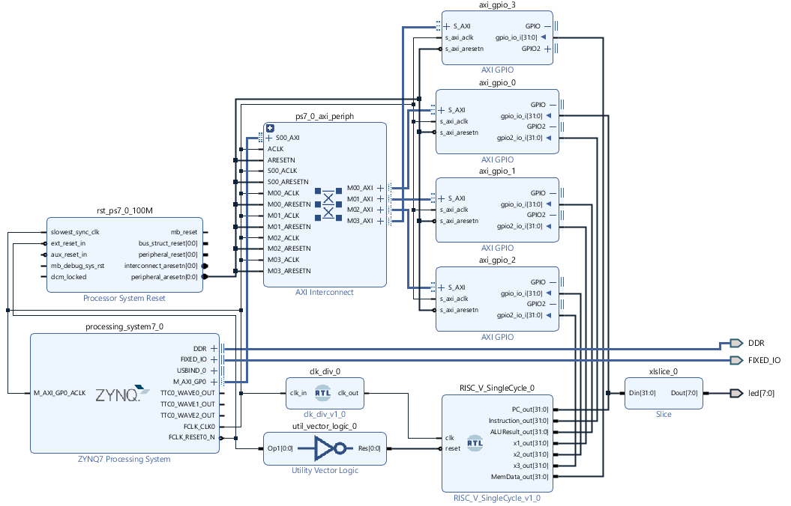
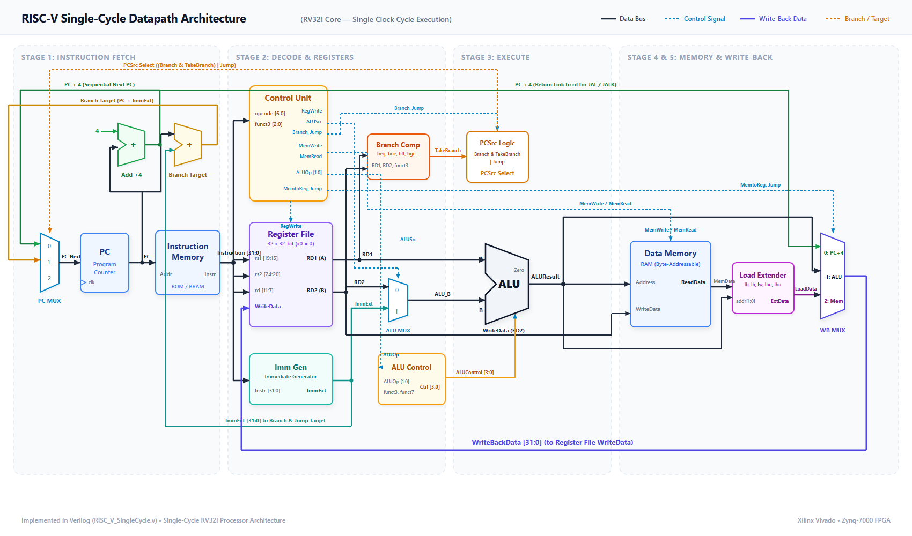
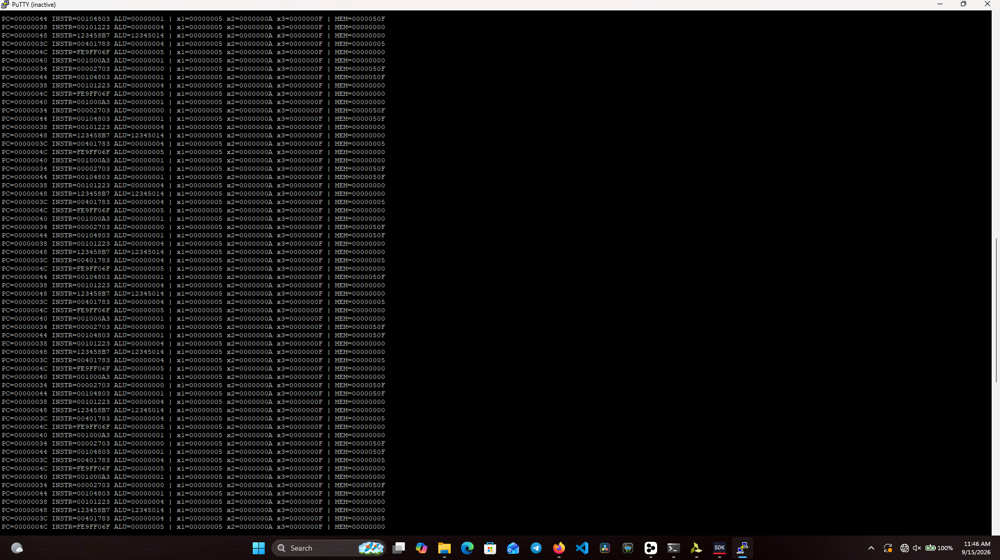

# RISC-V Single Cycle CPU

A single-cycle RV32I RISC-V CPU core implemented in Verilog, built as a Xilinx
Vivado project. The core is packaged as a reusable IP and integrated into a
Zynq-7000 (PYNQ-Z1/Z2, `xc7z010clg400-1`) block design so it can run on the
PS7 fabric alongside AXI GPIO peripherals, or be simulated standalone.



## Architecture

The CPU implements the classic single-cycle datapath (everything happens in
one clock edge, no pipelining):



### RTL modules (`RISC-V Single Cycle.srcs/sources_1/new`)

| Module | Description |
| --- | --- |
| `RISC_V_SingleCycle.v` | Top-level core; wires up all the modules below into the single-cycle datapath. |
| `ProgramCounter.v` | 32-bit PC register, synchronously reset to `0`. |
| `InstructionMemory.v` | Combinational ROM with a small hand-assembled test program. |
| `ControlUnit.v` | Decodes `opcode`/`funct3` into datapath control signals (`RegWrite`, `ALUSrc`, `MemWrite`, `MemRead`, `Branch`, `MemtoReg`, `ALUOp`, `Jump`). |
| `ImmGen.v` | Generates sign-extended immediates for I/S/B/U/J instruction formats. |
| `RegisterFile.v` | 32 x 32-bit register file, `x0` hard-wired to zero. |
| `ALUControl.v` | Maps `ALUOp`/`funct3`/`funct7` to the ALU operation. |
| `ALU.v` | Arithmetic/logic unit (add, sub, and, or, xor, shifts, slt/sltu). |
| `BranchComparator.v` | Evaluates branch conditions (`beq`, `bne`, `blt`, `bge`, `bltu`, `bgeu`). |
| `DataMemory.v` | Byte-addressable data memory supporting byte/half/word load & store. |
| `LoadExtender.v` | Sign/zero-extends `lb`/`lbu`/`lh`/`lhu` loads. |
| `top.v` | FPGA-level wrapper: clock divider, power-on reset, and PC display on LEDs, used for standalone (non-Zynq) bring-up. |
| `clk_div.v` | Simple clock divider utility. |

### Supported instructions

The control unit decodes the base RV32I opcode map:

- R-type ALU ops: `add`, `sub`, `and`, `or`, `xor`, `sll`, `srl`, `sra`, `slt`, `sltu`
- I-type ALU ops: `addi`, `andi`, `ori`, `xori`, `slli`, `srli`, `srai`, `slti`, `sltiu`
- Loads: `lb`, `lh`, `lw`, `lbu`, `lhu`
- Stores: `sb`, `sh`, `sw`
- Branches: `beq`, `bne`, `blt`, `bge`, `bltu`, `bgeu`
- Jumps: `jal`, `jalr`
- `lui`, `auipc`

## Block design (Zynq integration)

`RISC-V Single Cycle.srcs/sources_1/bd/design_1` wraps the core (packaged as
the `RISC_V_SingleCycle_v1_0` IP, see `mref/`) inside a Zynq-7000 processing
system block design:

- `processing_system7_0` — PS7 (ARM) subsystem, provides `M_AXI_GP0` and DDR/FIXED_IO.
- `ps7_0_axi_periph` — AXI interconnect fanning out to 4x `axi_gpio` peripherals.
- `RISC_V_SingleCycle_0` — the CPU core, clocked by `clk_div` and reset through `util_vector_logic`.
- `xlslice_0` — slices the CPU's debug bus down to `led[7:0]`.

This lets the PS (via the SDK/`hello_bsp` app) read out the CPU's internal
state (`PC`, `Instruction`, `ALUResult`, register values, memory data) over
AXI GPIO, and drives the board LEDs directly from hardware for a quick
visual check that the core is fetching/executing instructions.

The `hello_bsp` application streams these debug registers over UART, which
can be viewed live in a serial terminal (e.g. PuTTY):



## Simulation

Testbenches live in `RISC-V Single Cycle.srcs/sim_1/new`:

- `RISC_V_tb.v` — top-level core testbench, checks register contents against
  the expected results of the program in `InstructionMemory.v`.
- `ALU_tb.v`, `ALUControl_tb.v`, `ImmGen_tb.v`, `Memory_tb.v`, `RegisterFile_tb.v` — unit tests for individual modules.
- `program.hex` — sample machine code image.

Run any of these from Vivado's simulation sources (`Flow Navigator ->
Simulation -> Run Simulation`), or with a standalone simulator such as
Icarus Verilog:

```bash
iverilog -o sim.out "RISC-V Single Cycle.srcs/sources_1/new/*.v" \
  "RISC-V Single Cycle.srcs/sim_1/new/RISC_V_tb.v"
vvp sim.out
```

## Getting started

1. Open `RISC-V Single Cycle.xpr` in Vivado (2019.1+ recommended, part
   `xc7z010clg400-1`).
2. Run **Generate Block Design** if prompted, then **Run Synthesis ->
   Implementation -> Generate Bitstream**.
3. Program the target board (PYNQ-Z1/Z2) and observe the program counter on
   the LEDs, or use the SDK application in `hello_bsp` to read the debug
   registers over AXI GPIO.

Alternatively, for RTL-only work (no Zynq/board), instantiate `top.v` on its
own — it only needs a `clk`, `clk_en`, `reset_n`, and drives `led[7:0]`.

## Repository layout

```
RISC-V Single Cycle.xpr          Vivado project file
RISC-V Single Cycle.srcs/        RTL sources, constraints, testbenches, block design
hello_bsp/                       Xilinx SDK application/BSP (generated, gitignored)
docs/                            Local reference material (gitignored)
```

Build artifacts (`*.cache`, `*.runs`, `*.sim`, `*.ip_user_files`, `*.hw`,
`*.sdk`) are regenerated by Vivado from the project file and are excluded
from version control — see `.gitignore`.
